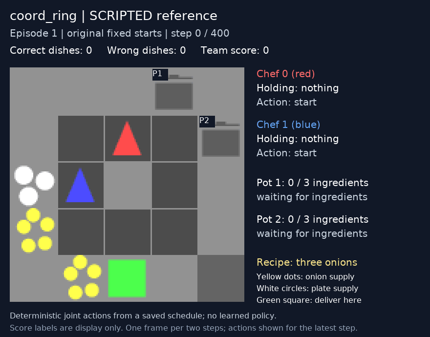

# Coordination Ring: two-chef maximum analysis

Date: 2026-10-12. Related issue: [#31](https://github.com/KayakKayla/multiagent-cooperation/issues/31).

## Result and what is proved

**18 soups (360 raw team reward) are achievable in 400 steps. The exact maximum is currently narrowed to 18 or 19 soups (360 or 380 reward).**

The saved 18-soup schedule was replayed successfully in the actual pinned JaxMARL simulator on CPU. Both chefs remain on distinct tiles throughout. The replay checks their positions, facing directions, inventories, both pot contents/timers, the central counter, reward, and termination against the saved trace at every step.

An independent optimistic action-flow calculation gives an upper bound of **19.609756… soups**. Since actual deliveries are whole soups, no valid schedule can exceed **19**. The search found 18, but did not prove that 19 is impossible. **Do not label 18 as a proven theoretical maximum or close the issue on that basis.** It is a verified achievable reference, with a one-soup optimality gap.

## Fixed starting state

Use the original `coord_ring` starting positions, with randomization disabled:

```text
          column
          0 1 2 3 4
    row 0 # # # P #
        1 # . A . P
        2 D B C . #
        3 O . . . #
        4 # O S # #
```

- `A`: chef 0, at `(2, 1)`.
- `B`: chef 1, at `(1, 2)`.
- `C`: the central counter at `(2, 2)`, initially empty; it is not walkable.
- `P`: pot; `O`: onion dispenser; `D`: plate dispenser; `S`: serving station.
- `.`: walkable floor; `#`: wall/counter.

Coordinates are `(column, row)`. Both chefs initially face up, carry nothing, and both pots and all counters are empty. Set `random_agent_positions=False` and `random_reset=False`. There is one recipe: three onions. Cooking starts automatically; the recipe stays fixed. The episode lasts exactly 400 joint action steps.

This document defines a separate fixed-start reference. **The existing training/evaluation configuration still randomizes starting positions; it was not edited.** A fair comparison against this reference requires evaluation from the same fixed state. The planner uses full state information; it does not establish what partially observing learned policies can achieve.

## Timing and collision rules

| Operation | Cost and constraint |
| --- | --- |
| Walk | One tile per action step; cardinal directions only. |
| Turn | A directional action changes facing and attempts to move in that same step. Turning toward a station stays in place because the station blocks movement. |
| Interact | One step, with the adjacent object in front of the chef. Moving and interacting require separate actions. |
| Carry | One onion, one plate, or one plated soup at a time. |
| Counter staging | One object per counter. Dropping and picking up each require an interaction. There is no direct chef-to-chef handoff action. |
| Cook | Timer is 20. The third-onion placement immediately ticks it down to 19. A soup filled on step `t` can first be picked up on step `t+20`. |
| Collect soup | One interaction while holding a plate. Empties the pot immediately. |
| Deliver | One interaction while holding soup and facing the serving station. Earns 20 shared reward, counted once. |
| Joint actions | Both chefs choose an action on every step. Cooking proceeds after their interactions. |
| Collision | Same-destination collisions cancel movement. Swapping adjacent positions in one step is also blocked. Facing still updates. |
| Interaction ordering | Chef 0's interaction is processed before chef 1's. Shared counter/pot operations must respect this ordering. |

Each soup needs at least nine basic interactions: three onion pickups, three pot placements, one plate pickup, one soup pickup, and one delivery. Walking, facing changes, and counter transfers cost additional actions. These costs overlap across chefs and across soups, so adding one soup's costs and dividing 400 by that sum would miss useful parallel work.

## How the 18-soup schedule works

The chefs circulate around the ring, take turns filling and collecting from both pots, and prepare the next onions while soup cooks. They use the central counter to transfer selected onions across the middle. Roles change during the episode; neither chef is permanently assigned to cooking or delivery.

For example, chef 1 stages an onion on the central counter from below on step 5. Chef 0 retrieves it from the right on step 12 and puts it into the east pot on step 15. This avoids carrying that onion all the way around the ring. Each transfer still costs a drop, a pickup, and the required facing actions. Staging arbitrarily many onions is not free: each counter holds only one object.

The first 15 steps are:

| Step | Chef 0 | Chef 1 |
| --- | --- | --- |
| 1 | left | down |
| 2 | down | interact |
| 3 | down | right |
| 4 | interact | up |
| 5 | up | interact |
| 6 | up | left |
| 7 | right | interact |
| 8 | right | up |
| 9 | interact | up |
| 10 | down | right |
| 11 | left | right |
| 12 | interact | interact |
| 13 | up | left |
| 14 | right | left |
| 15 | interact | down |

The east pot starts cooking on step 15, becomes ready at the end of step 34, is collected on step 36, and is delivered on step 41. Meanwhile, the north pot starts on step 30, becomes ready at the end of step 49, is collected on step 50, and is delivered on step 55.

The complete delivery sequence is:

```text
41, 55, 83, 97, 125, 139, 167, 181, 209,
223, 251, 265, 293, 307, 335, 349, 377, 391
```

This schedule averages two deliveries every 42 steps after the initial pair. That describes this schedule's throughput, not a proof that every possible schedule needs 42 steps.

**Follow the complete saved actions to reproduce it**, including the final nine steps:

- [400-step action/state table](theoretical-maximum-schedule.csv).
- [Machine-readable joint actions](theoretical-maximum-actions.json).
- [Original simulator verification result](theoretical-maximum-verification.json).

In the CSV, inventory codes are `0=empty`, `1=onion`, `2=plate`, `3=soup`; facing codes are `0=up`, `1=down`, `2=right`, `3=left`. Pot codes are `10=empty`, `11=one onion`, `12=two onions`, `13=cooked`, and `14..33=countdown 1..20`. These are audit encodings, not upstream object identifiers. Positions and contents are recorded after each step.

## Why the upper bound is 19

The bound models movement/facing/inventory as a flow through possible chef states. Each action costs one unit. Two chefs have at most `2 × 400 = 800` action units. It starts with exactly two empty-handed chefs at the specified positions, facing up, and allows them to finish anywhere with leftover items.

The model enforces:

1. Legal floor movement, facing changes, and inventory changes.
2. For each pot, at least three onion placements per soup collected.
3. For each counter and object type, no more pickups than drops; counters start empty.
4. Plates must come from the plate dispenser or a previously supplied counter.
5. Reward comes from soup delivered at the serving station.

It deliberately relaxes cooking delays, collisions, chronological ordering, and counter capacity. It also permits fractional action counts. These freedoms can only make its answer more optimistic. Every actual schedule maps to a feasible flow, while some flows cannot be performed by real chefs.

The solved linear program returns `19.60975609756097` deliveries. Thus:

```text
18 ≤ actual maximum ≤ floor(19.60975609756097) = 19
360 ≤ maximum raw team reward ≤ 380
```

The action-flow bound is stronger than simply counting nine interactions per soup. It includes the travel and facing work and permits staging on every reachable counter. It does not restrict the strategy to the central-counter pattern in the saved schedule.

## Reproduce the calculations

### View or regenerate the deterministic GIF



[Open the GIF](media/18-soups/rollout.gif). It shows the original fixed starts, both chefs' actions and inventories, pot status, deliveries, and shared score. It is a saved-action replay, not a learned policy or a proven optimal policy. The final frame shows 18 correct soups, no wrong deliveries, and 360 reward.

With the existing simulator environment installed, run from the repository root:

```powershell
.\overcooked-v2\run.ps1 scripted
```

Linux equivalent:

```bash
bash overcooked-v2/run.sh scripted
```

Both commands verify all 400 steps and save `rollout.gif`, `initial.png`, `final.png`, and `verification.json` under `docs/theoretical-maximum/media/18-soups/`. The Python command below also works directly when the pinned simulator and dependencies are available:

```bash
PYTHONPATH=overcooked-v2/JaxMARL python docs/theoretical-maximum/verify_theoretical_maximum.py --gif
```

### Audit and upper bound

From the repository root, the standard-library audit needs no ML packages:

```bash
python docs/theoretical-maximum/theoretical_maximum.py
```

The upper-bound script requires OR-Tools (the calculation here used `9.15.6755`), installed in a separate analysis environment:

```bash
python docs/theoretical-maximum/theoretical_maximum_bound.py
```

To replay in the actual simulator, use an environment with the project's JaxMARL dependencies and the pinned submodule available on `PYTHONPATH`:

```bash
PYTHONPATH=overcooked-v2/JaxMARL python docs/theoretical-maximum/verify_theoretical_maximum.py
```

The native verification here used CPU JAX `0.4.38`, NumPy `1.26.4`, Flax `0.10.2`, and Chex `0.1.88`, with a temporary checkout of the exact pinned simulator. No policy training or research experiment was launched. Upstream files were not modified.

## Remaining step to establish the exact maximum

### Additional 19-soup search (2026-10-12)

Three further collision-aware beam searches retained up to 20,000, 30,000, and 40,000 candidate states per step for all 400 steps. They allowed every reachable counter, both pots, onion/plate/soup staging, and role changes. All three found 18 soups; none found 19. One additional candidate was also checked successfully against the actual pinned simulator, delivering its eighteenth soup on step 387.

These searches used the upper-bound model's state potentials to reject paths that already spend too many actions to reach 19. A soup delivery is worth 41 potential units in this certificate, and one legal joint step can increase potential by at most two. Nevertheless, beam search also drops candidates to limit memory. **Failure to find 19 is not an exhaustive infeasibility proof.**

A stronger relaxed joint-state flow model included both chefs' movement and collision rules. It contained 14,336 joint states and 340,186 edges, but reached a 90-second solver limit without a certified new bound. That attempt does not change the established 19-soup ceiling.

[Search parameters and results](theoretical-maximum-search-results.json) are saved separately. The reproducible heuristic search uses only a C++17 compiler:

```bash
c++ -O3 -std=c++17 docs/theoretical-maximum/search_theoretical_maximum.cpp -o /tmp/coord-search
/tmp/coord-search 20000 0.02 40 > /tmp/coord-candidate.json
```

Arguments are beam width, a small bonus for cooking progress, and the number of remaining steps over which unfinished food is discounted. Progress goes to stderr; stdout is the candidate joint-action JSON. The other attempted settings were `30000 0.1 20` and `40000 0 60`. Ties and retained paths can differ across standard-library/compiler implementations.

To check a candidate in the actual simulator, specify its claimed soup count:

```bash
PYTHONPATH=overcooked-v2/JaxMARL python docs/theoretical-maximum/verify_theoretical_maximum.py \
  --actions /tmp/coord-candidate.json --expected-soups 18
```

If a search ever returns 19, use `--expected-soups 19 --gif --output /tmp/coord-19` to verify and visualize it. A verified 19-soup schedule would match the established upper bound and prove optimality for this starting state.

Either find a valid 19-soup schedule and replay it, or prove that 19 deliveries within 400 steps are infeasible. A finite-horizon exact planner must include both chefs, collisions, all counters, object capacity, pot timers, and interaction ordering. A bounded heuristic search returning 18, or a schedule that would deliver its nineteenth soup after step 400, does not provide that proof.

Until then, use **360 as the verified achievable reference** and **380 as an optimistic ceiling**. Neither should be described as a proven exact maximum.

## Pinned sources

Simulator revision: `976aeb152cb184a5095021968bba94da96eb6394`.

- [Original layout and starts](https://github.com/bold-lab-ai/JaxMARL/blob/976aeb152cb184a5095021968bba94da96eb6394/jaxmarl/environments/overcooked_v2/layouts.py).
- [Actions, directions, and object definitions](https://github.com/bold-lab-ai/JaxMARL/blob/976aeb152cb184a5095021968bba94da96eb6394/jaxmarl/environments/overcooked_v2/common.py).
- [Movement, collisions, interactions, cooking, reset, and episode termination](https://github.com/bold-lab-ai/JaxMARL/blob/976aeb152cb184a5095021968bba94da96eb6394/jaxmarl/environments/overcooked_v2/overcooked.py).
- [Cooking time and delivery reward](https://github.com/bold-lab-ai/JaxMARL/blob/976aeb152cb184a5095021968bba94da96eb6394/jaxmarl/environments/overcooked_v2/settings.py).
